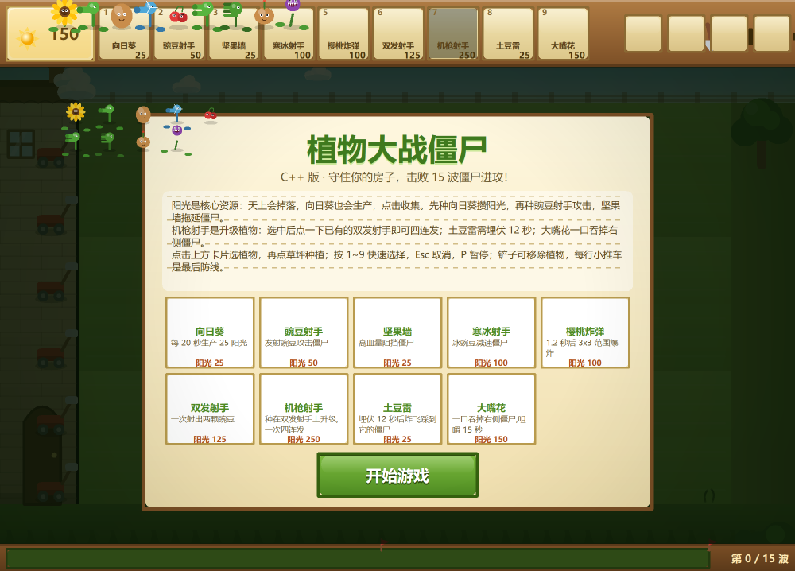
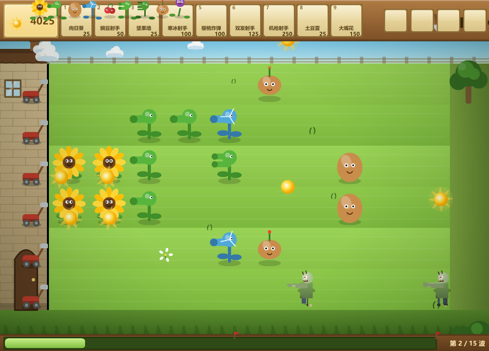
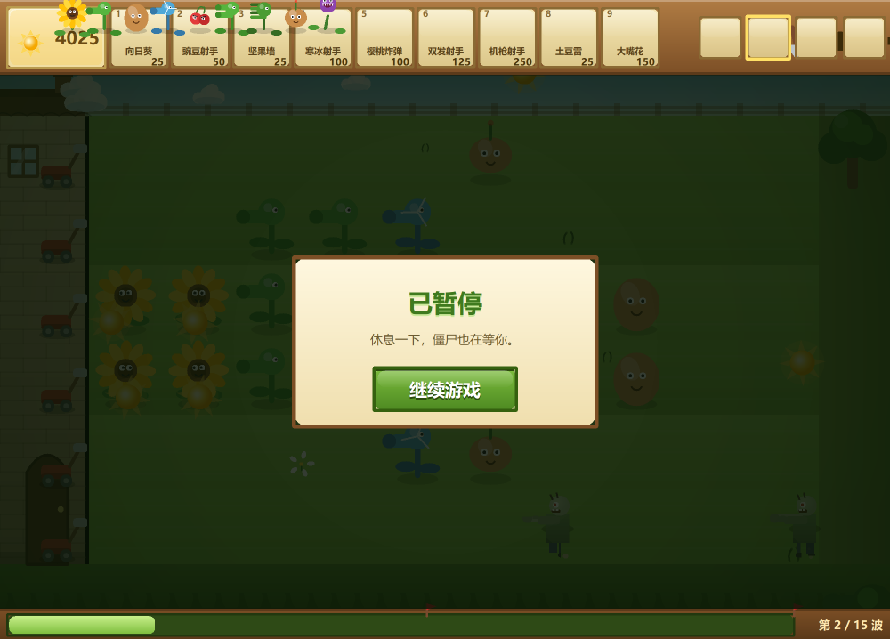

# 植物大战僵尸 · C++ 版

网页版《植物大战僵尸》的完整 C++ 移植。**零第三方依赖**：仅用 Win32 API + 自研软件光栅化渲染器，单文件源码，一条命令编译。

## 运行

双击 `pvz.exe` 即可（已静态链接，无需随附 DLL）。需要 Windows 7 及以上。

## 编译

任选其一：

```bat
build.bat
```

或手动（MinGW-w64）：

```bat
g++ -O2 -std=c++17 -static -municode -o pvz.exe pvz.cpp -lgdi32 -luser32 -lwinmm -mwindows
```

或 Visual Studio 开发人员命令提示符：

```bat
cl /nologo /O2 /EHsc /std:c++17 /DUNICODE /D_UNICODE pvz.cpp user32.lib gdi32.lib winmm.lib
```

> 注意：源码定义了 `UNICODE`，入口点为 `wWinMain`，MinGW 需加 `-municode`；
> 加 `-static` 生成独立 exe，否则需随附 `libgcc_s_seh-1.dll`、`libstdc++-6.dll`。

## 命令行模式

| 命令 | 说明 |
|---|---|
| `pvz.exe` | 启动游戏窗口 |
| `pvz.exe --selftest` | 无头自检：400 秒模拟 + 全实体渲染 + 胜负路径 |
| `pvz.exe --shot out.bmp 1` | 无窗口渲染并存 BMP（0=开始界面 1=战斗 2=暂停） |

## 操作

- **种植**：点击顶部种子栏选中植物，再点击草坪格子；按 `1`–`9` 快速选择
- **收集阳光**：点击掉落的阳光；向日葵会自动产出
- **铲子**：点击铲子（或按 `Q`）再点植物可移除
- **暂停**：`P` 或 `Esc`　　**快速选关卡**：战斗中无
- 每行一辆小推车，僵尸走到尽头时触发，救你一次

## 游戏内容

- **6×10 草坪**，15 波进攻，旗帜波多种族僵尸混编
- **9 种植物**：向日葵 25、豌豆射手 50、坚果墙 50、寒冰射手 25、樱桃炸弹 100、双发射手 125、机枪射手 250、土豆雷 25、大嘴花 150
- **7 种僵尸**：普通、路障、铁桶、旗帜、撑杆跳、报纸、橄榄球
- 难度已下调：向日葵 25 阳光、每 20 秒产阳光、僵尸数量减半
- 经济系统：初始 150 阳光，阳光掉落自动收集判定

## 技术要点

- **软件光栅化渲染器**：2× 超采样 + 盒式滤波降采样实现全画面抗锯齿
- **图元**：矩形/圆角矩形/椭圆/圆/圆弧/贝塞尔路径（扫描线填充）、描边、多停止点渐变
- **变换栈**：平移/缩放/旋转组合，局部坐标绘制
- **GDI 文本**：微软雅黑字体缓存，中文渲染
- **winmm 程序合成音效**：sin/square/saw/tri 波形 + 噪声 + 包络，内存 WAV 缓冲播放
- **静态背景缓存**：天空/草坪/房子等静态层预渲染，每帧只画动态实体
- **游戏逻辑 1:1 移植**自网页版：波次、AI、碰撞、经济数值完全一致

## 已知环境适配

- 部分隔离会话中屏幕 DC 上无法创建 `DIBSection`，代码改用兼容内存 DC 创建并带回退
- `BITMAPINFOHEADER.biPlanes` 必须设为 1（严格 GDI 环境会拒绝 0）
- 背景缓存切换时同步收窄缓冲高度全局量，避免越界写入

## 游戏截图

**开始界面**



**战斗画面**



**暂停界面**



## 文件

```
pvz.cpp                 单文件源码（约 2300 行）
pvz.exe                 编译好的可执行文件（817 KB，静态链接，双击即玩）
build.bat               一键编译脚本
screenshot-menu.png     开始界面实拍
screenshot-battle.png   战斗画面实拍
screenshot-pause.png    暂停界面实拍
```